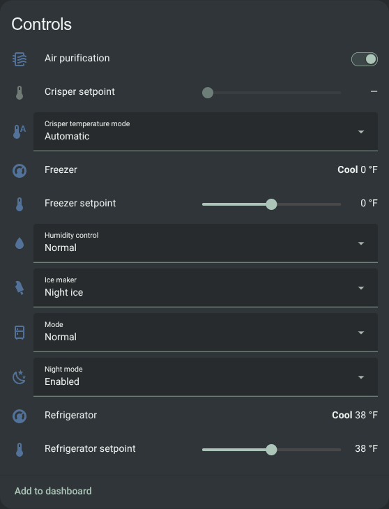
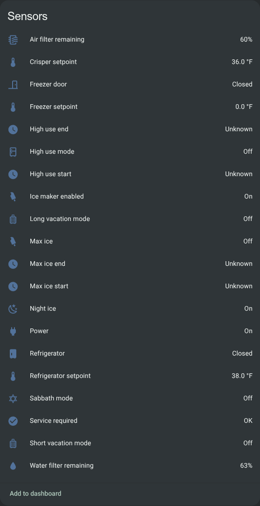
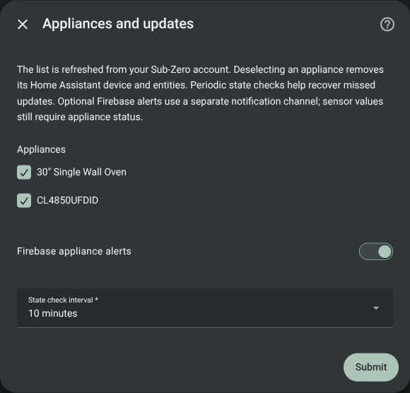

# Sub-Zero for Home Assistant


Monitor and control connected Sub-Zero, Wolf, and Cove appliances from Home Assistant. The integration uses Sub-Zero's cloud service over your appliances' existing Wi-Fi connections.

[](https://github.com/orienw/ha-subzero/releases/latest)
[](https://github.com/orienw/ha-subzero/releases)

## Installation

You need Home Assistant **2026.8.0 or newer** and an appliance already connected to your Sub-Zero Group Owner account. The Owner's App is available in [Canada, Mexico, and the United States](https://www.subzero-wolf.com/assistance/answers/multi-brand/sub-zero-group-owner-s-app-location-availability).

[](https://my.home-assistant.io/redirect/hacs_repository/?owner=orienw&repository=ha-subzero&category=integration)

1. Open **HACS**, search for **Sub-Zero**, and download it.
2. Restart Home Assistant.
3. Go to **Settings → Devices & services → Add integration → Sub-Zero**.
4. Sign in with your Sub-Zero account email and password, then select your appliances.

If your account uses multi-factor authentication, setup supports text-message codes and phone calls. It may also ask you to enter characters from an image. External-provider sign-in and other verification methods are not supported.

Use **Configure** on the integration to change your appliance selection. Deselecting an appliance removes its Home Assistant device and entities.

For manual installation, copy `custom_components/subzero` into your Home Assistant configuration's `custom_components` directory, restart, and continue from step 3.

## Features

Available controls and sensors depend on what each appliance reports. Entities can appear as new properties arrive; there is no model allowlist.

<table>
  <tr>
    <td valign="top"></td>
    <td valign="top"></td>
  </tr>
</table>

| Appliance | Controls and monitoring |
| --- | --- |
| [Refrigerators and freezers](docs/reference.md#refrigerators-and-wine-storage) | Temperature setpoints and climate entities, doors, filters, ice modes, Sabbath and vacation modes, crisper settings, humidity, lighting, and water dispenser |
| [Wine storage](docs/reference.md#refrigerators-and-wine-storage) | Setpoints, climate entities, display temperatures, doors, and operating modes for each zone |
| [Dedicated ice makers](docs/reference.md#dedicated-ice-makers) | Ice production, delay schedules, door status, filters, and cleaning status |
| [Wolf ovens](docs/reference.md#ovens) | Separate controls for each cavity, cooking modes, remote start, lights, probes, preheat status, cooking and kitchen timers, and Gourmet program status |
| [Wolf hoods](docs/reference.md#hoods) | Four fan speeds, task-light brightness and color temperature, halo lighting, automatic fan sensitivity, delayed shutoff, and control lock |
| [Cove dishwashers](docs/reference.md#dishwashers) | Cycle selection, remote start and cancel, delayed start, wash options, cycle progress, door status, rinse aid, and softener salt |

Temperatures use your preferred Home Assistant unit. Celsius setpoints may be rounded to the appliance's whole-degree Fahrenheit precision. Shared features include Wi-Fi signal strength and **Active faults**. The fault list refreshes every 30 minutes.

**Sub-Zero CL4850UFDID is the primary tested appliance.** Wolf SO3050PMSP status and push updates have also been tested. Other appliance types and controls have automated test coverage, but physical testing is limited. State recovery and Firebase alerts are still undergoing appliance testing.

### Using the controls

- **Refrigerators:** temperature setpoints are configured targets; measured temperatures appear only when the appliance reports them. Turn off Max ice before changing the freezer setpoint. Choose Manual crisper mode to adjust the crisper setpoint.
- **Dedicated ice makers:** use **Schedule ice delay** to pause production for 1–12 hours, optionally repeating daily. **End current ice delay** resumes production; **Cancel ice delay schedule** removes the schedule.
- **Ovens:** enable Remote Ready at the oven before each remote start. Opening the door cancels it. Broil, Convection broil, Proof, Self clean, and Gourmet must be started at the appliance. See [Wolf's Remote Ready guide](https://www.subzero-wolf.com/assistance/answers/wolf/m-series-oven/sub-zero-group-owners-app---set-up-remote-access).
- **Dishwashers:** to enable Remote Ready, hold ENTER for five seconds, then close the door within four seconds. Opening the door cancels it. Selecting a cycle does not start it. See [Cove's Remote Ready guide](https://www.subzero-wolf.com/assistance/answers/cove/dishwasher/cove-dishwasher-remote-ready-feature).

Appliance settings change only when you use a control or automation. See the [reference](docs/reference.md) for control ranges and model-specific behavior.

## Status updates

Normal updates arrive through push. By default, the integration also reads status every **ten minutes per appliance** to catch missed updates. Other push activity does not postpone these checks. Appliance alerts can trigger a few follow-up reads while the reported condition remains active.

In **Configure**, choose a one-, two-, five-, or ten-minute check interval, or **Push only**. Push only and Home Assistant's option to disable polling turn off both scheduled checks and alert follow-ups.



Cloud outages or delayed messages can leave sensors stale. Status reads help recover the current state, but cannot recreate every brief door movement. The optional **State confirmed** diagnostic sensor shows the last complete observation; enable it in the entity settings when needed.

### Check state before sending a reminder

Use **Sub-Zero: Read appliance status** before an automation checks whether a door is still open:

```yaml
- action: subzero.read_status
  data:
    device_id: YOUR_APPLIANCE_DEVICE_ID
- condition: state
  entity_id: binary_sensor.kitchen_refrigerator_door
  state: "on"
```

The action waits for a new status read and for its result to reach Home Assistant. If it cannot confirm state, it fails and stops the automation unless you enable `continue_on_error`.

## Appliance alerts

The **Appliance event** entity reports door-left-open alerts, preheat, timer completion, dishwasher events, and maintenance notifications. For ordinary door open/close changes, use the door binary sensor.

Automations match event type IDs such as `refrigerator_door_ajar`. Event attributes include the appliance timestamp, sequence, `source`, and `received_at`.

**Firebase appliance alerts** is optional and off by default. Enable it in **Configure** to receive alerts through the mobile app's separate Firebase channel. It feeds the same event entity; sensor values still come from appliance status. Details on [event history and duplicate handling](docs/reference.md#events-and-firebase-alerts) are in the reference.

## Troubleshooting

If an appliance is unavailable or its state looks wrong:

1. Check that it is online in the Sub-Zero Owner's App.
2. Run **Read appliance status** to request its current state.
3. Enable debug logging for `custom_components.subzero`, reproduce the problem, and save the logs.

You can download diagnostics from the integration or device page. Diagnostics omit account credentials, appliance names, serial numbers, and network identifiers. Debug logs include incoming updates and status-read results; review them for private information before sharing. See [diagnostics](docs/reference.md#diagnostics) for the available counters and sensors.

[Open an issue](https://github.com/orienw/ha-subzero/issues) with your Home Assistant version, integration version, appliance model, steps to reproduce, and relevant logs. Include whether the same operation works in the Sub-Zero app.

## Account and connection

Your password is used to sign in and is not saved. Home Assistant stores renewable account tokens; protect backups containing them. If token renewal fails, the integration asks you to sign in again.

This is an unofficial integration and is not affiliated with Sub-Zero Group. It requires internet access and uses the mobile app's cloud endpoints, which may change. Local appliance access is not supported. Bluetooth is not required.

## Development

Use Python 3.14:

```sh
python -m venv .venv
.venv/bin/pip install -r requirements-test.txt
.venv/bin/pytest
.venv/bin/ruff check .
.venv/bin/ruff format --check .
```

The [technical reference](docs/reference.md) covers state recovery, timestamps, event delivery, and command confirmation.
