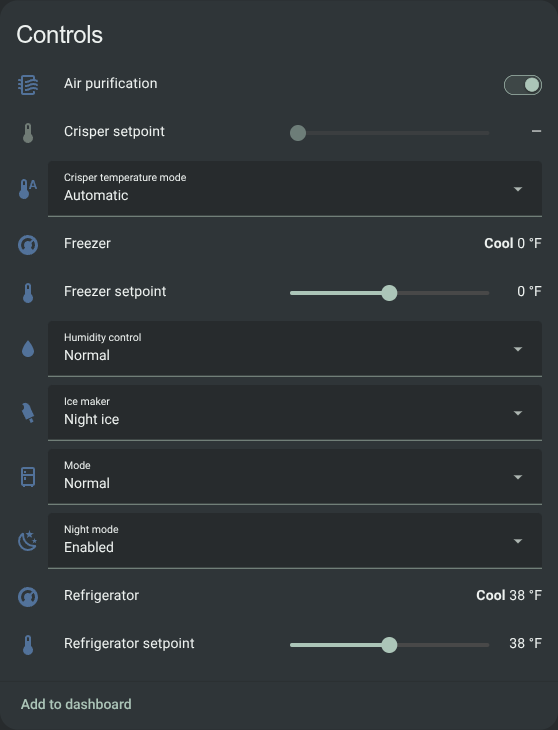
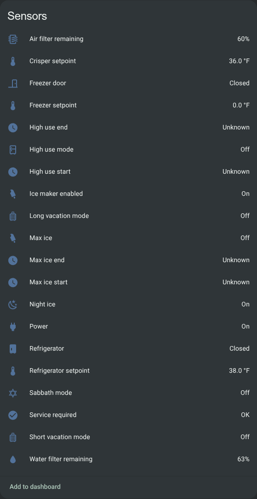
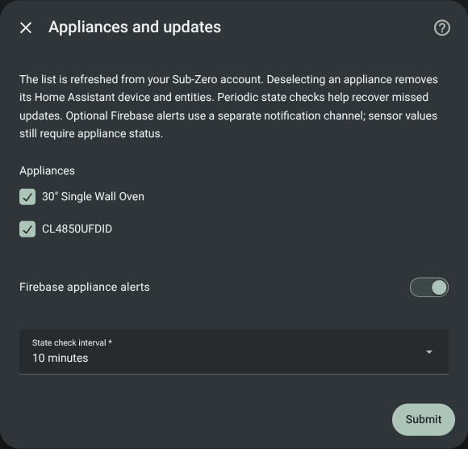

# Sub-Zero for Home Assistant


[](https://github.com/orienw/ha-subzero/releases/latest)

Monitor and control Wi-Fi-connected **Sub-Zero**, **Wolf**, and **Cove** appliances in Home Assistant.

This is an unofficial cloud integration and is not affiliated with Sub-Zero Group. It connects over the internet using your existing Sub-Zero Group Owner account and does not require Bluetooth. Local-only control is not supported.

## What it supports

Entities are created automatically from what each appliance reports, and new entities appear if additional properties are reported later. Installing, restarting, or reconnecting the integration never changes appliance settings on its own.

<table>
  <tr>
    <td valign="top"></td>
    <td valign="top"></td>
  </tr>
</table>

| Appliance | Controls and sensors |
| --- | --- |
| [Refrigerators and freezers](docs/reference.md#refrigerators-and-wine-storage) | Temperature setpoints and climate entities, door sensors, air and water filters, air filter reset, ice maker modes, Sabbath and vacation modes, crisper settings, humidity control, night mode, accent lighting, air purification, internal water dispenser, and door-open delay |
| [Wine storage](docs/reference.md#refrigerators-and-wine-storage) | Per-zone temperature setpoints, climate entities, display temperatures, door sensors, temperature alerts, and operating modes |
| [Dedicated ice makers](docs/reference.md#dedicated-ice-makers) | Ice maker on/off, status sensor, delay schedules, door status and door-open delay, water filter status, cleaning progress, Sabbath mode, failsafe, and winterization flags |
| [Wolf ovens](docs/reference.md#ovens) | Separate controls per cavity, cooking modes, remote start, interior lights, meat probes, preheat status, cooking and kitchen timers, broil level, and Gourmet program status |
| [Wolf hoods](docs/reference.md#hoods) | Four-speed fan, task-light brightness and color temperature, halo light, automatic fan sensitivity, delayed shutoff, button tones, control lock, and filter usage |
| [Cove dishwashers](docs/reference.md#dishwashers) | Cycle and mode selection, remote start and cancel, delayed start, wash options, cycle status and end time, door status, rinse aid, and softener salt |

Every appliance also includes an **Active faults** diagnostic sensor (refreshed every 30 minutes while Home Assistant polling is enabled) and an **Appliance event** entity for alerts, plus a **Wi-Fi signal** sensor when the appliance reports signal strength.

Temperatures are shown and controlled in your preferred Home Assistant unit. Because appliances accept whole-degree Fahrenheit setpoints, Celsius values may be rounded.

**Appliances that will not appear:** Models that [cannot connect to Sub-Zero's cloud](https://www.subzero-wolf.com/assistance/answers/multi-brand/sub-zero-group-owners-app-cannot-find-appliance) (including Wolf convection steam ovens, speed ovens, microwaves, and cooktops) cannot be added to Home Assistant.

## Installation

### Requirements

- Home Assistant **2026.8.0 or newer**
- A **Sub-Zero Group Owner account** (available in [Canada, Mexico, and the United States](https://www.subzero-wolf.com/assistance/answers/multi-brand/sub-zero-group-owner-s-app-location-availability)) with your appliances already connected to Wi-Fi

### Setup steps

[](https://my.home-assistant.io/redirect/hacs_repository/?owner=orienw&repository=ha-subzero&category=integration)

1. On Home Assistant 2026.11 or newer, open **Settings → Marketplace**. On earlier versions, open **HACS**. Search for **Sub-Zero** and download it.
2. Go to **Settings → Devices & services → Add integration → Sub-Zero**.
3. Sign in with your Sub-Zero account email and password, then select the appliances you want to add.

**Sign-in and security:** Your password is used only to sign in and is never saved. Home Assistant stores renewable account tokens, so protect any backups that contain them. If multi-factor authentication is enabled on your account, setup supports text-message codes, phone calls, and image character prompts; external sign-in providers and other verification methods are not supported.

**Manual installation:** Copy `custom_components/subzero` into your Home Assistant `custom_components` folder, restart Home Assistant, and continue from step 2.

## Configuration

Open **Configure** on the Sub-Zero integration at any time to adjust your setup:



- **Appliances:** Add newly connected appliances or remove existing ones. Deselecting an appliance removes its Home Assistant device and entities.
- **State check interval:** Updates normally arrive live via cloud push, so periodic checks default to **No periodic checks**. You can choose a 1-, 2-, 5-, or 10-minute interval as a safety net to catch missed updates. If live updates are interrupted, the integration automatically checks each appliance every minute until live updates recover, regardless of this setting.
- **Firebase appliance alerts:** Optional and off by default. Turn this on to receive appliance alerts over a separate Firebase notification channel into the same **Appliance event** entity. It delivers alerts only; sensor values still come from appliance status updates.

If you turn off Home Assistant's built-in **Enable polling for updates** system option for this integration, scheduled state checks (including checks during a push interruption), alert follow-up reads, and 30-minute **Active faults** refreshes are all paused.

## Using the controls

Several appliances enforce safety interlocks or require a specific mode before Home Assistant can change a setting:

- **Refrigerators and freezers:** Temperature sensors show configured setpoints; display temperatures appear only if the appliance reports them. Turn off **Max ice** before changing the freezer setpoint. Switch **Crisper temperature mode** to **Manual** before adjusting the crisper setpoint.
- **Dedicated ice makers:** Use the **Sub-Zero: Schedule ice delay** action to pause ice production for 1 to 12 hours, starting immediately or within the next 24 hours, with an option to repeat daily. Press **End current ice delay** to resume production while keeping a repeating schedule, or **Cancel ice delay schedule** to remove the schedule.
- **Wolf ovens:** Turn on **Remote Ready** at the oven before each remote start; opening the door cancels it. Choose the cooking mode and temperature in Home Assistant (including on newer E series and M series ovens) and press **Start oven**. On older E series and M series ovens, set the mode and temperature at the oven first, then press **Start oven**. Broil, Convection broil, Proof, Self clean, and Gourmet must be started at the oven. See [Wolf's Remote Ready guide](https://www.subzero-wolf.com/assistance/answers/wolf/m-series-oven/sub-zero-group-owners-app---set-up-remote-access).
- **Cove dishwashers:** Choose the wash cycle and options, hold **ENTER** for five seconds, and close the door within four seconds when prompted to enable **Remote Ready**; opening the door cancels it. Selecting a cycle does not start the wash; press **Start wash cycle** to begin. Cycle and mode can only be changed while the dishwasher is idle or waiting to start. See [Cove's Remote Ready guide](https://www.subzero-wolf.com/assistance/answers/cove/dishwasher/cove-dishwasher-remote-ready-feature).

See the [reference guide](docs/reference.md) for temperature ranges, timers, probes, hood controls, and model-specific details.

## Automations and alerts

### Reacting to appliance alerts

Use the **Appliance event** entity to automate on appliance alerts such as doors left open, setpoint changes, wine temperature alerts, expired filters, ice maker clean cycles, oven preheat, probe milestones, finished timers, self-clean completion, and dishwasher cycle or supply warnings. For ordinary door open/close state changes, use the door binary sensor instead.

In automations, match the event entity's `event_type` attribute (for example `refrigerator_door_ajar`, `oven_preheated`, or `dishwasher_complete`). Events also include `code`, `sequence`, `appliance_timestamp`, `source`, and `received_at` attributes. See the reference for [all event types](docs/reference.md#event-types) and [event history and duplicate handling](docs/reference.md#events-and-firebase-alerts).

### Confirming state before sending reminders

Because cloud updates can occasionally be missed, call **Sub-Zero: Read appliance status** (`subzero.read_status`) before checking whether a door is still open:

```yaml
- action: subzero.read_status
  data:
    device_id: YOUR_HOME_ASSISTANT_DEVICE_ID
- condition: state
  entity_id: binary_sensor.kitchen_refrigerator_door
  state: "on"
```

Select your appliance in Home Assistant's action editor to fill in `device_id`, and replace the door entity ID with your own.

The action waits for a fresh status read and for the updated state to reach Home Assistant. The action errors (stopping the automation unless you enable `continue_on_error`) if the read fails, the state changes, or the live connection drops or reconnects during the read.

## Troubleshooting

### Common issues

- **An appliance is unavailable or its state looks stale:** During a cloud push interruption, established readings stay available for up to two minutes and turn unavailable only if neither a live update nor a status read reconfirms state in time. While Home Assistant polling is enabled, automatic one-minute checks run during push outages and extend that window as long as status reads succeed, though values can be up to a minute old and brief changes between checks will not be seen. Run **Sub-Zero: Read appliance status** to request fresh state, verify the appliance is online in the Sub-Zero Group Owner's App, and consider enabling a **State check interval** in **Configure** if updates are frequently missed. You can also enable the disabled **State confirmed** diagnostic sensor to see when state was last confirmed.
- **A control is unavailable or refuses changes:** Check the appliance interlocks in [Using the controls](#using-the-controls), such as **Remote Ready** on ovens and dishwashers, **Max ice** on freezers, and **Manual** crisper temperature mode.
- **An appliance is missing:** Confirm the model is cloud-connected (see [What it supports](#what-it-supports)), and open **Configure** to make sure it is checked.
- **Repair says "Firebase appliance alerts aren't working":** This appears after three consecutive failures. Firebase alerts use a separate channel from regular appliance updates, and the repair clears automatically once alerts succeed again. To stop trying, turn off **Firebase appliance alerts** in **Configure**.
- **Home Assistant asks you to sign in again:** Your renewable account tokens expired or were rejected. Follow Home Assistant's re-authentication prompt to sign in again.

### Reporting a bug

If an appliance stays unavailable or behaves unexpectedly, capture diagnostics in this order before resetting anything:

1. Enable debug logging for `custom_components.subzero`, reproduce the problem, and note the time.
2. Download diagnostics from the integration or device page **before** requesting a status read, opening the Sub-Zero app, or reloading the integration.
3. Run **Sub-Zero: Read appliance status**, check whether the appliance is online in the Sub-Zero Group Owner's App, and save the debug logs.

Diagnostics omit account credentials, appliance names, serial numbers, and network identifiers. Debug logs include appliance updates and status-read results, so review them for private information before sharing. See [diagnostics](docs/reference.md#diagnostics) for what each diagnostic field records.

[Open an issue](https://github.com/orienw/ha-subzero/issues) with your Home Assistant version, integration version, appliance model, steps to reproduce, diagnostics, and relevant logs. Mention whether **Read appliance status** corrected the state and whether the same action works in the Sub-Zero app.

## Further reading and development

The [technical reference](docs/reference.md) documents detailed appliance behavior, all event types, diagnostics, state recovery, and command confirmation. Because this integration relies on Sub-Zero's cloud service, cloud changes can affect functionality.

To run the test suite and linter locally (Python 3.14):

```sh
python -m venv .venv
.venv/bin/pip install -r requirements-test.txt pytest-homeassistant
.venv/bin/pytest
.venv/bin/ruff check .
.venv/bin/ruff format --check .
```
